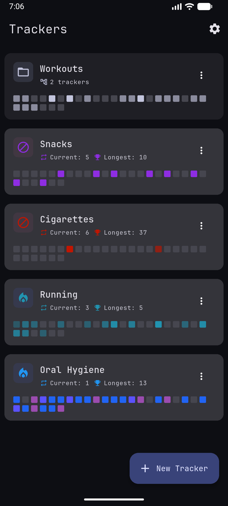
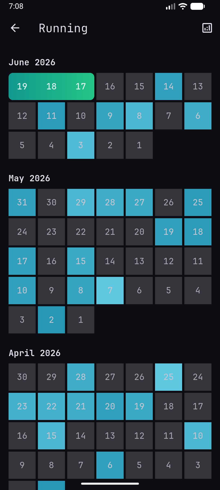
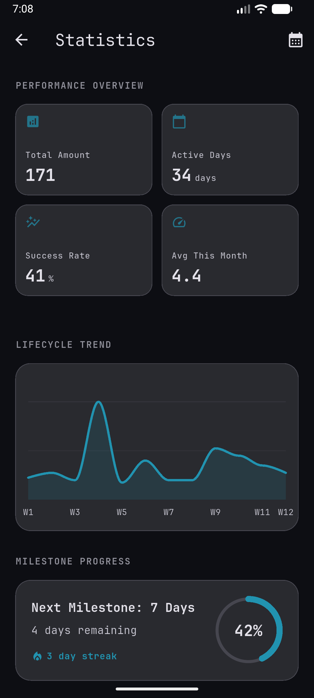

# sy


[](LICENSE)


A secure, high-performance, multi-platform habit and streak tracker built with Flutter, Riverpod, and Isar.

## Screenshots

<p align="center">
  
  
  
</p>

## Features

- **Flexible Tracking**: Support for Toggle, Choice, and Quantity-based trackers.
- **Secure Vault**: Encrypted trackers with PBKDF2 hashing and AES encryption.
- **Biometric Unlock**: Access your private trackers with fingerprint or face ID.
- **Fast Performance**: Isar-backed persistence with off-isolate bulk calculations.
- **Beautiful UI**: Modern Material 3 design with AMOLED support.

## Architecture

State is managed with Riverpod providers; persistence uses Isar with heavy calculations offloaded to isolates to keep the UI thread free. Trackers are schema-driven, supporting toggle, choice, and quantity types with a shared streak engine.

## Getting Started

### Prerequisites

- Flutter SDK (^3.9.0)
- Android Studio / VS Code with Flutter extension

### Installation

1. Clone the repository.
2. Run `flutter pub get`.
3. Generate Isar schemas:
```bash
   dart run build_runner build --delete-conflicting-outputs
```
4. Run the app:
```bash
   flutter run
```

## Testing

This project includes a comprehensive test suite covering unit logic, widget rendering, and in-memory Isar repository integration.

To run the local test suite:
```bash
flutter test
```

*Note: The repository integration tests rely on Isar's native library. On Windows, ensure you have run `flutter build windows` at least once so the tests can locate `libisar.dll`.*

## Continuous Integration

We use GitHub Actions to enforce code quality on `main`. Every pull request and direct push triggers:

1. `dart format` — code style
2. `flutter analyze` — lint and static analysis
3. `flutter test` — regression coverage across 80+ tests

Please ensure all three pass locally before opening a pull request.

## Contributing

Contributions are welcome. Please open an issue before starting significant work so we can align on direction. Follow the existing branch and commit conventions, and make sure CI passes on your PR.
