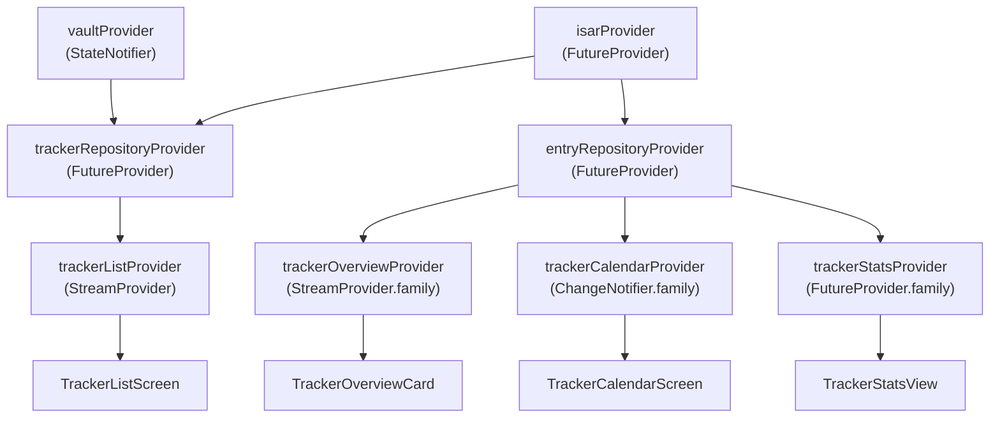

# sy3 — Codebase Structure & Performance Analysis

## Architecture Overview

The app is a Flutter + Riverpod + Isar habit/streak tracker. The layer breakdown is clean and well-separated:

```
lib/
├── main.dart                   # App entry, theme loading, vault lifecycle
├── theme.dart                  # AppThemeMode enum
├── data/                       # Persistence layer
│   ├── database.dart           # App-level data classes (Tracker, Entry, PrivacyLevel…)
│   ├── isar_database.dart      # Isar open helper
│   ├── providers.dart          # Riverpod FutureProviders for repos + streams
│   ├── tracker_repository.dart # CRUD + encryption for trackers
│   ├── entry_repository.dart   # CRUD + streak recalc for entries
│   ├── tracker_config.dart     # TrackerConfig model + JSON serialization
│   └── schemas/                # Isar schema classes + generated code
├── logic/                      # Business logic / state
│   ├── vault_provider.dart     # Vault unlock/lock, biometrics, PBKDF2 hashing
│   ├── theme_provider.dart     # Theme selection persistence
│   ├── tracker_calendar_provider.dart  # Calendar month data + stream subscription
│   ├── tracker_overview_provider.dart  # 28-day overview grid data
│   └── tracker_stats_provider.dart     # Full stats (total, rate, weekday distribution)
├── screens/
│   ├── tracker_list_screen.dart        # Main list, vault unlock header, reorder
│   ├── tracker_calendar_screen.dart    # Per-tracker calendar + stats tab
│   └── settings_screen.dart           # Settings, vault config, theme
├── widgets/
│   ├── tracker_overview_card.dart  # Card shown in list (mini 4×7 grid)
│   ├── tracker_editor_sheet.dart   # Create/edit bottom sheet
│   ├── tracker_stats_view.dart     # Stats tab content
│   ├── tracker_calendar.dart       # Calendar grid widget
│   ├── tracker_value_bottom_sheet.dart # Entry input sheet
│   ├── month_section.dart          # Month row in calendar
│   └── gradient_picker.dart        # Color picker widget
└── utils/
    ├── color_utils.dart        # Hex parse, interpolate
    └── encryption_utils.dart   # AES encrypt/decrypt, PBKDF2, salt gen
```

---

## Data & Provider Flow



---

## Performance Issues & Concerns

### 🔴 High Priority

#### 1. `trackerRepositoryProvider` re-instantiates on every vault state change
**File:** [providers.dart](file:///c:/Users/marce/projects/sy3/lib/data/providers.dart#L23-L29)

```dart
final trackerRepositoryProvider = FutureProvider<TrackerRepository>((ref) async {
  final isar = await ref.watch(isarProvider.future);
  final vault = ref.watch(vaultProvider);   // ← watches entire VaultState
  return TrackerRepository(isar, vault);
});
```
[TrackerRepository](file:///c:/Users/marce/projects/sy3/lib/data/tracker_repository.dart#31-237) is rebuilt (and `trackerListProvider` stream restarted) on **every** change to `vaultProvider`, including `isBiometricsEnabled` or `isScreenProtectionEnabled` toggles that have nothing to do with access level. This causes the full tracker list to reload unnecessarily.

**Fix:** Only watch the fields that affect query filtering:
```dart
final vault = ref.watch(vaultProvider.select((s) => (s.unlockedLevel, s.activeKey)));
```

#### 2. Async call inside scroll listener — can fire multiple times rapidly
**File:** [tracker_list_screen.dart](file:///c:/Users/marce/projects/sy3/lib/screens/tracker_list_screen.dart#L155-L195)

```dart
void _onScroll() async {
  ...
  final isConfigured = await ref.read(vaultProvider.notifier).isVaultConfigured();
  ...
}
```
[_onScroll](file:///c:/Users/marce/projects/sy3/lib/screens/tracker_list_screen.dart#155-196) is called on every scroll frame. The `await isVaultConfigured()` hits `FlutterSecureStorage` (a platform channel call) on each over-scroll tick, and the guard (`!_showVaultHeader`) only prevents re-entry from completing, not from being called. Multiple in-flight reads can race.

**Fix:** Cache the `isConfigured` result (it only changes when the user configures or clears the vault) or debounce the trigger, or add an `_isCheckingVault` flag similar to `_isUnlocking`.

---

### 🟡 Medium Priority

#### 3. [_setupStream()](file:///c:/Users/marce/projects/sy3/lib/logic/tracker_calendar_provider.dart#149-164) is called after [loadMorePastMonths()](file:///c:/Users/marce/projects/sy3/lib/logic/tracker_calendar_provider.dart#334-361) — creates a new stream subscription
**File:** [tracker_calendar_provider.dart](file:///c:/Users/marce/projects/sy3/lib/logic/tracker_calendar_provider.dart#L334-L360)

When the user scrolls to the past in the calendar, [loadMorePastMonths](file:///c:/Users/marce/projects/sy3/lib/logic/tracker_calendar_provider.dart#334-361) fetches older data then calls [_setupStream()](file:///c:/Users/marce/projects/sy3/lib/logic/tracker_calendar_provider.dart#149-164) again, which cancels the old subscription and creates a new one with an expanded date range. This is correct in goal but means:
- A brief window exists where `_entries` holds merged data from the old fetch and the new stream fires again with only the new range, potentially duplicating inserts or causing flicker.
- The new stream fires `fireImmediately: true`, so [_updateState()](file:///c:/Users/marce/projects/sy3/lib/logic/tracker_calendar_provider.dart#165-174) will run synchronously.

The optimistic update path in [saveEntry](file:///c:/Users/marce/projects/sy3/lib/data/entry_repository.dart#64-96) adds a fake entry with `id: -1` and then relies on the stream to overwrite it — correct, but if the stream fires before [saveEntry](file:///c:/Users/marce/projects/sy3/lib/data/entry_repository.dart#64-96) completes, the calendar briefly shows the correct data, then re-renders, which is fine but worth noting.

#### 4. `jsonDecode(configJson)` + full `TrackerConfig.fromJson()` on every tracker load
**File:** [tracker_repository.dart](file:///c:/Users/marce/projects/sy3/lib/data/tracker_repository.dart#L14) and [entry_repository.dart](file:///c:/Users/marce/projects/sy3/lib/data/entry_repository.dart#L43)

Every call to `_toTracker()` / [_isarTrackerToTracker()](file:///c:/Users/marce/projects/sy3/lib/data/entry_repository.dart#36-50) deserializes the JSON config. Since [watchAllTrackers()](file:///c:/Users/marce/projects/sy3/lib/data/tracker_repository.dart#90-98) fires on every Isar write (including streak updates), this runs for every tracker in the list on each streak save. For small tracker counts this is fine, but deserves an eye if lists grow.

#### 5. Streak refresh writes one tracker at a time inside a single `writeTxn`
**File:** [entry_repository.dart](file:///c:/Users/marce/projects/sy3/lib/data/entry_repository.dart#L190-L199)

```dart
await _isar.writeTxn(() async {
  for (final update in updates) {
    final row = await _trackers.filter().uuidEqualTo(update.id).findFirst();
    ...
    await _trackers.put(row);
  }
});
```
Querying inside a `writeTxn` is not recommended in Isar (queries in write transactions can cause issues or be slower). Prefer fetching all rows before the transaction, then writing them all in batch.


---

### 🟢 Low Priority / Notes

#### 7. `trackerOverviewProvider` map-sorts 28-day dayMap on every stream event
**File:** [tracker_overview_provider.dart](file:///c:/Users/marce/projects/sy3/lib/logic/tracker_overview_provider.dart#L40-L41)

The map keys are inserted in sorted order already (`start + i`), so the `.sort()` is redundant — it's safe to remove and replace with `dayMap.values.toList()`. Tiny gain but eliminates an O(n log n) sort for each card on every entry change.

#### 8. Theme loading in [main.dart](file:///c:/Users/marce/projects/sy3/lib/main.dart) blocks the first frame with a spinner
**Status:** ✅ **Resolved**. Theme decoding moved to a background isolate via `compute()`.
Both JSON themes were loaded in parallel, but `ThemeDecoder.decodeThemeData` was synchronous. Moved to background isolate to keep UI thread fluid.

#### 9. [lockVault](file:///c:/Users/marce/projects/sy3/lib/logic/vault_provider.dart#141-156) calls `preventScreenshotOn` then immediately `preventScreenshotOff`
**Status:** ✅ **Resolved**. Pointless `On` call removed when locking.
**File:** [vault_provider.dart](file:///c:/Users/marce/projects/sy3/lib/logic/vault_provider.dart#L147-L154)

---

## Technical & UX Backlog

### 🟠 Feature & UX Improvements

#### 10. Custom Font Loading Delay ("Add tracker" button)
**Issue:** The "Add tracker" text in the FAB (Floating Action Button) or related headers appears to load its custom font significantly later than the system UI on cold start.
**Status:** Identified. Likely due to `GoogleFonts` or custom asset resolution happening after the first frame.

#### 11. Vault Unlock Performance & Masking
**Issue:** Unlocking the vault triggers a significant performance hit (rebuilding the repository and list). This needs to be masked with a smooth animation or transition to feel "premium."
**Status:** High Priority. Ties into addressing the `trackerRepositoryProvider` rebuild issue (#1).

#### 12. Statistics Panel Overhaul
**Issue:** The current stats view is functional but basic. It needs a major design overhaul and more user-configurable options (e.g., date ranges, custom metrics).
**Status:** Planned.

#### 13. Settings Page Expansion
**Issue:** The settings screen is currently minimal. Needs to support more app-wide configurations, vault management options, and possibly data export/import UI.
**Status:** Planned.

### 🔵 Administrative / Infrastructure

#### 14. Project Documentation & README
**Issue:** [README.md](file:///c:/Users/marce/projects/sy3/README.md) is still the default Flutter template. Needs custom project context, setup instructions, and architecture notes.
**Status:** Pending.

#### 15. App Naming & Branding
**Context:** The app name "sy3" is an evolution of "sober yet?". As the project evolves beyond simple sobriety tracking into a general habit/streak tool, the branding needs a refresh.
**Status:** Discussion required.

#### 16. Workflow Migration
**Goal:** Transition to a structured GitHub issue -> Branch -> PR/Resolution workflow to manage the increasing complexity of the app.
**Status:** Long-term goal.

---

## What's Well-Done ✅

- **Isolate for bulk streak recalculation** — [refreshAllStreaks](file:///c:/Users/marce/projects/sy3/lib/data/entry_repository.dart#167-205) correctly uses [compute()](file:///c:/Users/marce/projects/sy3/lib/data/entry_repository.dart#240-312) to offload streak math to a background isolate, preventing jank on app startup.
- **Optimistic UI updates** — [saveEntry](file:///c:/Users/marce/projects/sy3/lib/data/entry_repository.dart#64-96) in the calendar provider updates the in-memory `_entries` list and calls [_updateState()](file:///c:/Users/marce/projects/sy3/lib/logic/tracker_calendar_provider.dart#165-174) before the async DB write, so the calendar reacts instantly.
- **`autoDispose` on calendar provider** — Prevents stale Isar stream subscriptions accumulating when navigating away from the calendar screen.
- **Pre-parsed color arrays** — `_streakColors` and `_intensityColors` are parsed once in [_init()](file:///c:/Users/marce/projects/sy3/lib/logic/tracker_calendar_provider.dart#97-108), avoiding repeated hex-string parsing in the hot [_generateMonthsData()](file:///c:/Users/marce/projects/sy3/lib/logic/tracker_calendar_provider.dart#175-333) loop.
- **Day-granularity date normalization** — Consistently uses `DateTime(y, m, d)` midnight dates everywhere, avoiding DST edge-case bugs.
- **Secure storage + PBKDF2** — Vault PINs are hashed with PBKDF2 + random salt stored in `FlutterSecureStorage`, not plain text. Migration from legacy SharedPreferences pin format is handled transparently.
- **Reorder preserves hidden vault trackers** — [reorderTrackers](file:///c:/Users/marce/projects/sy3/lib/data/tracker_repository.dart#180-210) works with the full sorted list and only remaps the visible slot indices, so encrypted trackers don't get their sort order clobbered.

---

## Summary Table

| # | Severity | Area | Issue |
|---|----------|------|-------|
| 1 | 🔴 High | [providers.dart](file:///c:/Users/marce/projects/sy3/lib/data/providers.dart) | `trackerRepositoryProvider` rebuilds on any vault state change |
| 2 | 🔴 High | [tracker_list_screen.dart](file:///c:/Users/marce/projects/sy3/lib/screens/tracker_list_screen.dart) | Async secure storage read inside scroll listener (no debounce/guard) |
| 3 | 🟡 Med | [tracker_calendar_provider.dart](file:///c:/Users/marce/projects/sy3/lib/logic/tracker_calendar_provider.dart) | Stream re-subscription on each "load more" |
| 4 | 🟡 Med | [tracker_repository.dart](file:///c:/Users/marce/projects/sy3/lib/data/tracker_repository.dart) | `jsonDecode` + full config parse on every tracker list emission |
| 5 | 🟡 Med | [entry_repository.dart](file:///c:/Users/marce/projects/sy3/lib/data/entry_repository.dart) | Query-inside-writeTxn pattern in streak batch update |
| 7 | 🟢 Low | [tracker_overview_provider.dart](file:///c:/Users/marce/projects/sy3/lib/logic/tracker_overview_provider.dart) | Redundant sort on already-ordered map |
| 8 | 🟢 Low | [main.dart](file:///c:/Users/marce/projects/sy3/lib/main.dart) | Synchronous theme JSON decoding on main isolate at startup |
| 9 | 🟢 Low | [vault_provider.dart](file:///c:/Users/marce/projects/sy3/lib/logic/vault_provider.dart) | Dead `preventScreenshotOn()` call in [lockVault](file:///c:/Users/marce/projects/sy3/lib/logic/vault_provider.dart#141-156) |
